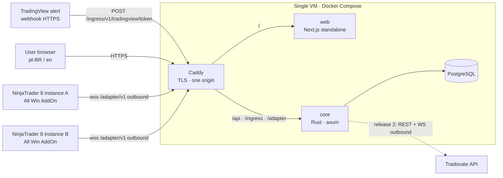

# ADR-0001 — Technology stack and runtime architecture

- **Status:** Accepted (2026-10-23) — approved by the user with conditions on A2/A3 (see §16 and [decisions.md](../../delivery/decisions.md))
- **Owner:** Software Architect
- **Answers:** product-vision.md §13 open question #1 (stack). Question #2 (identifiers) is deferred to ADR-0003 (see §12).
- **Inputs:** [product-vision.md](../../product/product-vision.md) rev. 3, delivery decisions of 2026-10-23.

## 1. Context

All Win routes trade instructions from sources (TradingView webhook now, own signal engine later, NinjaTrader master accounts) through a Core to executors (NinjaTrader 8 accounts in release 1, Tradovate in release 2, more later). Here is what drives the stack:

- **Correctness over throughput.** A duplicated or late order costs real money. We need idempotency by `message_id`, exact decimals, auditable state transitions, and a rule that we never auto-resync after a disconnect (§8 of the vision).
- **Platform neutrality.** Nothing in the Core may be hard-wired to a platform (§4, §5).
- **Heterogeneous clients.** A web app (pt-BR + en, mobile browsers), a NinjaTrader 8 plugin (NinjaScript/C#, .NET Framework 4.8, Windows only, inside the NinjaTrader process), and later a server-side Tradovate integration.
- **Small scale, few users.** Nothing documented asks for horizontal scale, high availability or SLOs. Per the role rules, none are invented here.
- **Team defaults.** Rust backend with mandatory DDD/Clean Architecture, and Next.js/TypeScript with shadcn/ui.
- **Current environment.** The dev host `/srv/www/allwin` (Ubuntu 24.04, 12 cores, 47 GB RAM) has **git only**: no Rust, Node, Docker or PostgreSQL. DevOps must provision toolchains before the first scaffold.

## 2. Decision summary

| Concern | Decision |
|---|---|
| Core | **Rust** (stable toolchain pinned by `rust-toolchain.toml`), **axum + tokio**, one deployable binary: a modular monolith built from independent business crates, each with `enterprise` / `application` / `infra` crates and wiring in `app`. |
| Database | **PostgreSQL** (current major supported by the chosen host, at least 16). Access through **sqlx** with compile-time-checked queries and committed offline metadata. `NUMERIC` for every price, P&L and money value. |
| Decimals | `rust_decimal` in Rust, `System.Decimal` in C#, and **decimal values serialized as JSON strings** on every wire contract. |
| Web | **Next.js (App Router) + TypeScript + Tailwind + shadcn/ui**, i18n with **next-intl** (`pt-BR`, `en`), data through a typed client generated from OpenAPI with TanStack Query. The Next.js server only renders and routes; it holds no business logic and has no database access. |
| Auth (users) | Implemented in the Core: email + password (argon2id), server-side sessions in PostgreSQL, `HttpOnly; Secure; SameSite=Lax` cookie, optional TOTP 2FA. The Core is the only authority. |
| Auth (sources/adapters) | A per-source **ingress secret** for webhooks and a per-instance **device token** for plugins, obtained through a pairing code. Only hashes are stored, and both can be revoked in the web app. |
| Input adapter: TradingView | HTTPS webhook endpoint in the Core. It validates, persists idempotently, answers within TradingView's timeout, and routes asynchronously in-process. |
| Core ↔ platform adapters | **WebSocket (wss) + JSON**, opened outbound by the adapter. Versioned protocol with acks, at-least-once delivery, idempotent consumers (`command_id`, `event_id`) and command expiry. |
| Core → browser realtime | **Server-Sent Events** from the Core, with REST for every write. |
| NinjaTrader 8 plugin | NinjaScript **AddOn** as a thin host layer (`net48`, references NinjaTrader DLLs) over a platform-free **`netstandard2.0`** library that holds the protocol client, state machine, idempotency store and risk math. The library can be unit-tested on Linux CI. |
| Tradovate (release 2) | Server-side Rust adapter crate that implements the same Output port as the plugin gateway. |
| Contracts | JSON Schema for the standard instruction and the adapter protocol, OpenAPI 3.1 for the web API. All are **spec-first** in `contracts/`, with shared example fixtures that every language must pass (see ADR-0002). |
| Hosting (assumption) | One Linux VM running Docker Compose: Caddy (TLS + reverse proxy, one origin), `core`, `web`, PostgreSQL with off-site backups. Dev/staging on this host. The production region is a user decision (see §11). |
| Observability | `tracing` with structured JSON logs and **mandatory secret redaction**. A business **audit log** in the database, visible to the user, kept separate from the technical logs. |

## 3. Runtime view (C4 container level)

## 4. Core service and the Input/Output adapter boundary

The Core is **one process** made of business modules (bounded contexts). Modules talk to each other only through **domain events** (in-process, published after commit) and **query ports** (traits owned by the consuming module, implemented in `app` wiring). Target modules are listed below; each crate is created only when the first slice needs it.

| Module | Responsibility |
|---|---|
| `identity` | Users, sessions, TOTP, ingress secrets, adapter device tokens and pairing |
| `catalog` | Global reference data: instruments (tick size, point value, session), versioned prop firm presets |
| `accounts` | User accounts, multipliers, maximum position size, stop/target profiles, signal-type selection, enable/disable/pause |
| `risk` | Limit evaluation, trading-day calendar and resets, blocks, 80 % warnings |
| `routing` | Instruction intake (dedupe by `message_id`), routing plan per target account, sizing, correlation map for modify/cancel/replication |
| `gateway` | Venue-neutral execution: the **Output port**, adapter sessions, command delivery/outbox, execution-report intake, out-of-sync detection |
| `performance` | Trades and metrics, both captured and manually entered |
| `audit` | User-visible timeline of every automatic action and its reason (subscribes to events) |

**Ports, so the Core never knows a platform:**

- **Input port:** `routing::application::SubmitInstruction` accepts the *standard instruction* plus an authenticated `SourceContext { user_id, source_id, source_type }`. Each Input adapter translates its transport into this call:
  - `core/adapters/tradingview`: HTTP webhook (server-side crate).
  - Master-account input from plugins: the plugin builds the standard instruction itself and sends it over the adapter protocol. The gateway forwards it to the same port.
  - Phase 2 signal engine: a future in-process producer of the same call.
- **Output port:** `gateway::application::ExecutionVenue` delivers a venue-neutral `ExecutionCommand` to one target account and returns results as `ExecutionReport` events. There are two kinds of implementation:
  - *Connected-client venues* (NinjaTrader plugin and future plugins) connect **to** the Core over the adapter protocol.
  - *Server-side venues* (Tradovate in release 2) are Rust crates where the Core connects **out** to the platform API.
- The routing domain works in neutral terms: quantities as integers, stop/target distances normalized to **ticks** of the instrument, prices as decimals. Venue-specific order types and conversions stay inside the adapters.

**Durability without a queue.** An accepted instruction, its routing plan and every per-target command are rows in PostgreSQL with explicit state machines (outbox pattern). In-process tasks drive delivery. After a restart the Core reloads pending work, and any command past its expiry is marked `expired` and surfaced as out-of-sync, **never executed late**. This needs no broker, cache or second service.

**Single-instance constraint.** Adapter sessions live in memory in one Core process. Horizontal scaling would need session affinity or pub/sub. That is out of scope until a documented requirement exists.

## 5. TradingView webhook ingress

- **Endpoint:** `POST /ingress/v1/tradingview/{token}` over HTTPS on port 443. TradingView only calls ports 80/443 and does not support IPv6, so the host must expose IPv4.
- **Body:** TradingView sends `application/json` when the message parses as JSON and `text/plain` otherwise. The endpoint accepts both and parses the body as the standard instruction (schema v1, ADR-0003). It enforces a 16 KiB size limit.
- **Secret (decided, A3): in the webhook URL.** Each source has a token of at least 256 bits of randomness, formatted `awk_<key_id>_<secret>` (`key_id` alphanumeric, `secret` base64url, so the token is path-safe), and used as the last path segment. The indicator stays secret-free and the URL is entered once in the alert dialog.
  - The Core stores `key_id` and a SHA-256 hash of the secret, compares in constant time, and binds the token to one `(user_id, source_id, source_type)`.
  - The web app shows the full URL **once**, at creation or rotation. Afterwards only `awk_<key_id>_…` is shown. Rotation and revocation are immediate.
  - A secret in the body is **not** accepted (option A rejected by the user). The instruction schema has no credential field and rejects unknown top-level properties.
- **Masking in every log (user condition on A3).** The secret part of the token must never appear in any log, trace, metric label, error message or audit entry. Only the `key_id` may appear.
  - **Caddy:** access logs use the `filter` log encoder with a `regexp` filter on `request>uri` that replaces `(/ingress/v1/tradingview/awk_[A-Za-z0-9]+)_[A-Za-z0-9_-]+` with `${1}_REDACTED`. If the installed Caddy version cannot filter that field, ingress paths are excluded from access logs entirely (`log_skip`), with a separate, Core-side request log. DevOps verifies the exact directive syntax against the installed Caddy version. Error and debug logs must not echo request URIs.
  - **Core:** HTTP tracing records the matched route template (`/ingress/v1/tradingview/{token}`), never the raw URI. The token extractor wraps the value in a `Secret` type whose `Debug`/`Display` print `awk_<key_id>_REDACTED`. Panics and error responses never include the path.
  - **Audit log:** stores `source_id` and `key_id` only.
  - **Verification gate:** an automated test sends a request with a known token through Caddy and the Core, and asserts the secret string is absent from Caddy logs, Core logs and audit rows. The test is part of V1-S1 acceptance and is re-run whenever logging configuration changes.
- **Processing budget:** TradingView abandons webhooks that take longer than about 3 s. The ingress authenticates, validates against the schema, inserts with `UNIQUE (user_id, message_id)` and answers `200` immediately. A duplicate returns `200 {"status":"duplicate"}` and nothing is re-executed. Routing runs asynchronously after commit. Rejections (bad schema, unknown version, revoked secret) are recorded in the audit log, without the secret, so the user sees *why*.
- **Defense in depth:** per-key and per-IP rate limits. TradingView's published source-IP allowlist is optional and configurable, never the only control. Raw bodies are logged only after redaction.

## 6. Realtime channel between the Core and platform adapters

**Transport:** the adapter opens a WebSocket over TLS to `wss://<host>/adapter/v1`, authenticated with `Authorization: Bearer <device token>` on the upgrade request. Outbound-only connections need no inbound ports on the trader's Windows machine. `System.Net.WebSockets.ClientWebSocket` is available on .NET Framework 4.8 on Windows 8 or later, so the plugin needs no extra transport dependency.

**Pairing:** in the web app the user creates a *connection* (one per NinjaTrader instance) and gets a short-lived one-time pairing code. The plugin exchanges the code for a long-lived device token, stored with Windows DPAPI (`ProtectedData`, CurrentUser). The token can be revoked in the web app.

**Protocol essentials** (full contract in ADR-0004):

- **Envelope:** `{ protocol_version, msg_id, type, sent_at, payload }`. The first message is `hello`, carrying adapter type and version, instance id, visible accounts (connection and account name), adapter clock and locale. The Core answers `welcome` (accepted, or rejected with `unsupported_version`, which the plugin shows as "update required") plus the current limits snapshot for the mapped accounts.
- **Core → adapter:** `command` (execute, modify, cancel, flatten), `limits` (risk configuration for local enforcement), `ack`.
- **Adapter → Core:** `ack`, `execution_report` (accepted, filled with price/qty, partially filled, rejected, cancelled, expired), `position_snapshot` (periodically and on change, for out-of-sync detection), `instruction` (master-account input in the standard format), `risk_event` (warning, limit hit, flattened, blocked), `heartbeat`.
- **Delivery:** at-least-once. Each side retransmits unacked messages after reconnect, and each side dedupes on receipt:
  - The adapter keeps a **durable local store of processed `command_id`s** for at least the trading day, so a retransmitted command is acknowledged but not executed again.
  - The Core enforces `UNIQUE(event_id)` on reports.
  - `command_id` is deterministic per `(instruction_id, target_account_id, step)`, so a Core restart cannot mint a second id for the same work.
- **Ordering:** commands for one account are sent and applied in sequence over the single connection of that instance.
- **Expiry:** every command carries `expires_at`. The Core does not send expired commands after a reconnect, and the adapter rejects a command received after `expires_at`, using the clock skew measured at `hello`. An expired command becomes an out-of-sync alert, and the user decides (vision §8: "alert and wait, never auto-resync"). **TTL (Q16, decided): short default, editable per account.** The value and field are specified in ADR-0004.
- **Reconnect:** exponential backoff with jitter. After a reconnect the adapter sends `position_snapshot` for every mapped account **before** any new command is accepted, and the Core flags divergences instead of correcting them.
- **Local enforcement while offline:** the plugin caches the last `limits` per account and keeps monitoring P&L, flattening and blocking without the Core (the second barrier of vision §5). It reports the resulting `risk_event`s once reconnected.

**Rejected transports:**

- **gRPC:** grpc-dotnet does not run on .NET Framework, and Grpc.Core is deprecated.
- **SignalR:** no first-class Rust server.
- **MQTT or another broker:** adds infrastructure without a need.
- **Long polling or SSE+POST:** higher latency, two channels to keep consistent.

## 7. NinjaTrader 8 plugin architecture

- **Host:** a NinjaScript **AddOn**, not a Strategy. An AddOn sees every account in the instance (`Account.All`), subscribes to order, execution, position and account events, submits, changes and cancels orders, and flattens.
- **Two assemblies:**
  - `AllWin.Adapter.Core` (`netstandard2.0`, no NinjaTrader references) holds the protocol client, reconnect, idempotency store, command state machine, decimal and tick conversions, limit evaluation, and localized strings (pt-BR/en). It is unit-tested on Linux CI with `dotnet test`.
  - `AllWin.NinjaTrader` (`net48`, references the NinjaTrader DLLs on a Windows machine only) maps NinjaTrader events and API calls to the core library and provides the plugin window (status, 80 % warnings, pairing).
- **Doubles at the boundary:** the NinjaTrader API uses `double` for prices. They are converted to `decimal` immediately with the instrument's tick rounding, and all P&L math in the plugin uses `decimal`.
- **Simulation guard:** non-release builds refuse to act on any account that is not on a Sim or Playback connection. This enforces "agents use simulation only" in code (vision §11).
- **Blocking is reactive:** as far as is known, NinjaTrader exposes no API to lock an account. A blocked account is enforced by immediately cancelling or flattening any new order. The PO should write acceptance criteria accordingly.
- **Playback:** trading-day and daily P&L logic uses the connection's time, not wall-clock time, so Playback tests are meaningful.
- **To verify in an early spike (Plugin Researcher/Engineer)** before plugin slices are planned in detail:
  - NinjaTrader loading a `netstandard2.0` dependency next to the AddOn DLL.
  - Bundled vs. NinjaTrader-shipped JSON library: avoid version conflicts and prefer what NinjaTrader already loads.
  - Order `Name`/tag limits, used to carry a short `command_id` reference for reconciliation after a plugin restart.
  - Availability of built-in risk templates.
  - Distribution as a NinjaScript export package.

## 8. Database, exact decimals and per-user isolation

- **PostgreSQL:** `NUMERIC` with explicit precision and scale for prices, P&L and money, defined per column with the Database Architect. Never `float`/`double precision`/`real`.
- **Rust:** `rust_decimal` types wrapped in domain newtypes (`Price`, `Money`, `Ticks`, `Quantity` as integers, `Multiplier` as a positive integer). Ingress JSON parsing must not go through `f64`: decimal fields are strings in the schema.
- **TypeScript:** the browser displays decimals from strings and does no money arithmetic. If a calculation is ever needed client-side, it uses `decimal.js` behind one helper. Formatting is locale-aware (pt-BR `1.234,50`) for display only, and input parsing goes through one exact decimal parser.
- **Time:** all instants are `timestamptz` in UTC. Trading-day logic uses IANA time zones (`America/Chicago` for CME; each firm's reset time is stored with its zone in the preset).
- **Identifiers:** UUIDv7 (time-ordered) for Core entities.
- **Per-user isolation:**
  - Every user-owned table carries `user_id`, and every repository method takes a `UserId` from the authenticated context. Unscoped queries on user data fail code review.
  - Global reference data (`catalog`) is the only unscoped data. User edits of presets are stored as user-scoped copies.
  - Cross-user access tests are mandatory for every endpoint.
  - **Recommendation**, pending Database Architect consult: also enable PostgreSQL **Row-Level Security** on user-owned tables from the first migration. It is a second barrier and is cheap to add now, expensive to retrofit.
- **Secrets at rest:** passwords use argon2id. Ingress secrets and device tokens are stored as SHA-256 hashes. Third-party credentials (Tradovate, release 2) are encrypted with AES-256-GCM, with the key supplied by the environment or a secret store, never committed.
- **Migrations:** `sqlx migrate`, forward-only, in `core/migrations/`, reviewed by the Database Architect. Never assume a migration is reversible.

## 9. Web application, auth and i18n

- **Rendering:** Next.js App Router, `output: "standalone"`, served behind Caddy on the **same origin** as the Core API.
- **Data:**
  - The browser calls `/api/v1/*` with the session cookie.
  - Default rule: data fetching happens client-side through the generated typed client and TanStack Query. Server Components are used for layout, i18n and static shells. Any server-side data fetching needs architect review, to avoid two authorization paths.
  - Live updates (out-of-sync, warnings, routing results, account state) arrive over SSE (`/api/v1/events`).
- **Feature boundaries:** `src/features/<feature>/` (accounts, risk, routing, signals, performance, connections, settings) and `src/shared/` (ui from shadcn, api client, i18n, formatting). Features do not import each other's internals.
- **Auth:**
  - Login and registration are Core endpoints.
  - CSRF is mitigated by `SameSite=Lax` plus Origin/Host checks on state-changing requests.
  - Login and TOTP endpoints are rate-limited.
  - Next.js middleware only redirects unauthenticated users to the login page, and is never trusted for authorization.
  - Whether registration is open or invite-only is decided: **invite-only** in V1 (PO Q6). **Optional TOTP** 2FA is included in V1 (A5).
- **i18n:**
  - `next-intl` with locale-prefixed routes (`/pt-BR/...`, `/en/...`). The default locale is `pt-BR`; the user's preference is stored in their profile and also sent to the plugin in `welcome`.
  - The Core returns **stable error codes** (e.g. `risk.limit_reached`), never translated text. Clients translate them.
  - CI checks that both message catalogs have identical keys.
- **Mobile:** responsive layouts with Tailwind/shadcn; no native app (vision §3).

## 10. Testing strategy

| Layer | Tests | Runs on |
|---|---|---|
| Rust `enterprise` | Pure unit tests; property tests (`proptest`) for sizing, max-position capping, tick/point/dollar conversion, trailing drawdown, trading-day boundaries | Linux CI |
| Rust `application` | Use-case tests with in-memory fakes of ports | Linux CI |
| Rust `infra` | Integration tests against a real PostgreSQL (container or CI service), including cross-user isolation and idempotency races (concurrent duplicate `message_id`) | Linux CI |
| Core API | In-process HTTP tests, plus a drift check of the canonical OpenAPI against the implementation | Linux CI |
| Contracts | Every language validates `contracts/**/examples/valid/*` and rejects `invalid/*` | Linux CI |
| `adapter-sim` | A Rust binary that speaks the adapter protocol as a fake venue (fills, rejects, partial fills, disconnects, slow acks), used for Core E2E without NinjaTrader | Linux CI |
| Web | Vitest + Testing Library; Playwright E2E against the composed stack with seed data and `adapter-sim`; i18n key parity | Linux CI |
| Plugin core | `dotnet test` on `AllWin.Adapter.Core` (protocol, idempotency, expiry, limit math) | Linux CI |
| Plugin host | Scripted manual or semi-automated checklist on **NinjaTrader 8 Sim/Playback on Windows** | Windows test machine (PO Q15) |
| Security | Secret-redaction tests on logs, authorization matrix tests, dependency audit (`cargo audit`, `pnpm audit`) | Linux CI |

Agents never use live accounts. A real-money check is done only by the user (vision §11).

## 11. Hosting assumptions

- **Topology:** one Linux VM with Docker Compose: Caddy (automatic TLS), `core`, `web`, PostgreSQL, plus a scheduled encrypted off-site backup with a tested restore. DevOps/SRE own the details. No Kubernetes, no managed queue, no cache.
- **Region (decided, A2):** production in a **US central region, near Chicago**. Latency between the Core and the NinjaTrader instances is on the critical path of master replication (two hops), while TradingView webhooks originate in the US.
- **Deploys:** outside trading hours until a high-availability requirement exists. The trade-off is that downtime during market hours means missed webhooks, since TradingView is not known to retry. This is an accepted risk under the approved single-VM topology.
- **Network exposure:** opening any firewall port (on this host, the production VM or the user's Windows machine) requires **explicit user authorization** each time. Production needs only 443 (and 80 for the ACME/HTTP→HTTPS redirect, if authorized). PostgreSQL is never exposed publicly.
- **Environments:** `dev` (this host) and `staging`/`prod` as decided with DevOps. Agents only ever connect simulation accounts to any environment.

## 12. Identifiers for modify/cancel and replication (open question #2)

These will be defined in **ADR-0003 (instruction contract v1)**. The preliminary model, for planning only:

| Identifier | Assigned by | Purpose |
|---|---|---|
| `message_id` | source | Dedupe, so the Core never executes the same id twice per user |
| `refs.position_ref` | source | Groups entries and exits of one logical position (e.g. a master position) |
| `refs.order_ref` | source | Identifies a source order, so `modify`/`cancel` target it |
| `instruction_id` | Core | Accepted instruction |
| `command_id` | Core | One unit of work per target account (deterministic, see §6) |
| `platform_order_id` | adapter | The venue's order id, returned in execution reports |

The Core keeps a correlation map `order_ref → [(target_account, command_id, platform_order_id)]`. That map is how a master stop move fans out as `modify` commands, and how orphan-order cancellation finds every child order.

**Blocking:**

- It does **not** block the slices for accounts/presets/risk, auth, or webhook ingress with `buy/sell/close/reverse`, provided schema 1.0 reserves the optional `refs` object from day one.
- It **does** block the slices for `modify`/`cancel` and master-account replication.
- ADR-0003 and ADR-0004 are the architect's next deliverables after S0 approval, delivered before the ingress slice starts (contract-first).

## 13. Alternatives considered

| Alternative | Rejected because |
|---|---|
| TypeScript/Node backend (NestJS) | Weaker guarantees for exact decimals and exhaustive state machines; departs from the team default without a requirement-based reason |
| .NET backend (shared C# with the plugin) | Code sharing is small (the plugin is `net48`/`netstandard2.0`, the wire contract is JSON); departs from the team default; the DDD crate rules are Rust-specific |
| Microservices / message broker (Kafka, NATS, RabbitMQ) | No scale or isolation requirement; PostgreSQL state machines plus in-process events cover durability with less to operate |
| Redis for sessions/dedupe | PostgreSQL unique constraints and session tables suffice at this scale |
| Auth as a service (Clerk, Auth0) or Auth.js in Next.js | Splits the auth authority from the Core, which also authenticates webhooks and plugins; external dependency and cost; per-user data stays in our database |
| Keycloak | Operational weight that is not justified for single-tenant-per-user email/password plus TOTP |
| Next.js static export | Dynamic routes need workarounds; the Node server cost is small. Server role is kept minimal instead |
| BFF in Next.js route handlers | Duplicates authorization and business rules outside the Core |
| gRPC / SignalR / MQTT for the plugin channel | See §6 |
| NinjaScript Strategy instead of AddOn | A Strategy is bound to one instrument/account; replication and risk need every account in the instance |
| Floating-point (`f64`/`double`/JS `number`) for money | Violates the precision requirement (vision §11) |
| Local master→follower replication inside one NinjaTrader instance from day one | Duplicates sizing/stop/target/risk logic in C# and Rust, and bypasses the Core's first risk barrier and audit. Rejected for V1 by the user (A4); revisit only if measured Core-relay latency is unacceptable |

## 14. Consequences

- **Positive:**
  - One deployable Core with compile-time-enforced layer boundaries.
  - Exactly one implementation of routing and risk rules.
  - Any platform is added by writing an adapter against two stable contracts.
  - Plugin logic is testable without Windows.
  - No infrastructure beyond VM, PostgreSQL and a reverse proxy.
- **Negative / risks:**
  - Single instance means a host or deploy outage stops routing (no HA).
  - Plugin host verification depends on a Windows + NinjaTrader 8 machine (PO Q15).
  - Spec-first contracts need discipline: drift checks in CI.
  - `netstandard2.0` loading inside NinjaTrader is unverified (spike).
  - Core-relay replication adds network latency that has not been measured yet.
- **Reversibility:**
  - The Next.js choice is local to `web/`.
  - The transport is behind the adapter protocol, so another transport could be added as a new protocol version.
  - The database choice is the hardest decision to reverse.

## 15. Adoption plan

1. ~~User approves this ADR, ADR-0002 and the root `CLAUDE.md` (S0).~~ Done 2026-10-23.
2. DevOps provisions the toolchains (Rust, Node LTS + pnpm, .NET SDK for `netstandard2.0` tests, Docker, PostgreSQL), creates `.gitignore` and the initial commit, and sets up GitHub Actions CI once the private GitHub remote exists (A6; push only with user authorization).
3. The architect delivers ADR-0003 (instruction contract v1 + identifiers) and ADR-0004 (adapter protocol v1), with schemas and fixtures in `contracts/`.
4. In parallel: an NinjaTrader 8 spike (§7), plus scaffolding of `core/` with `app`, `shared-kernel` and `contracts` crates and of `web/` with the shell and i18n. Each business crate is created by the slice that needs it.
5. Walking skeleton: TradingView webhook → Core → `adapter-sim`, then the same flow → NinjaTrader 8 plugin on Sim101 → execution report back.

## 16. User decisions (2026-10-23)

All recommendations were accepted, with conditions. Details are in [s0-decisions-needed.md](../s0-decisions-needed.md) and [decisions.md](../../delivery/decisions.md):

- **A1:** stack as above.
- **A2:** production in the US central region, near Chicago.
- **A3:** secret in the URL, masked in every log (see §5).
- **A4:** master replication always relays through the Core in V1.
- **A5:** optional TOTP.
- **A6:** private GitHub repository + GitHub Actions; push only with user authorization.
- **Related product decisions:** Q6 invite-only, Q7 the user shares the Pine source, Q15 the build/test approach is defined by the NinjaTrader 8 spike plan before the machine is provided, Q16 short TTL editable per account.
