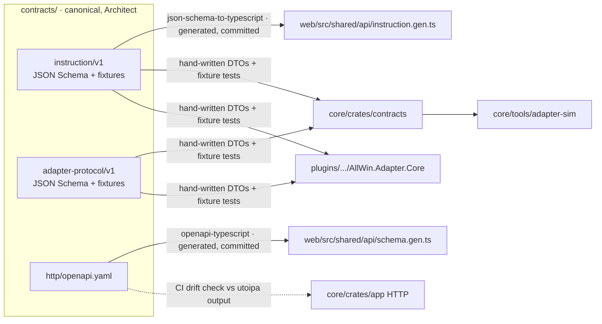

# ADR-0002 — Repository structure, ownership and contract flow

- **Status:** Accepted (2026-10-23) — approved by the user
- **Owner:** Software Architect
- **Depends on:** [ADR-0001](0001-technology-stack.md)

## 1. Context

Several agents work in parallel on `/srv/www/allwin`: Backend Rust, Frontend, Plugin Engineer, DevOps, QA, Database Architect, SRE, PO, Maestro and Architect, spread across workspaces Dev2 and Dev3. The repository has no commits and no remote yet. We need:

- one place for each component;
- clear single-writer ownership per directory;
- contracts that unblock parallel work;
- a branch/worktree convention that keeps agents from colliding in one checkout.

## 2. Decision: a single monorepo

```
/srv/www/allwin/
├── CLAUDE.md                      # project rules for all agents (Architect; user approves)
├── README.md                      # human entry point (DevOps, once scaffolded)
├── .gitignore  .editorconfig  .gitattributes
├── Makefile                       # task entry points: make check, make gen, make dev (DevOps)
├── docs/
│   ├── product/                   # PO: product vision, release slice plans
│   ├── delivery/                  # Maestro: board, decisions log, delivery logs
│   ├── architecture/              # Architect: ADRs, diagrams, contract notes
│   │   └── adr/NNNN-title.md
│   └── runbooks/                  # SRE/DevOps: operations, backup/restore, incident notes
├── contracts/                     # Architect: canonical wire contracts (spec-first)
│   ├── instruction/v1/
│   │   ├── instruction.schema.json
│   │   └── examples/{valid,invalid}/*.json
│   ├── adapter-protocol/v1/
│   │   ├── messages.schema.json
│   │   └── examples/{valid,invalid}/*.json
│   └── http/
│       └── openapi.yaml           # web ↔ Core API, grown slice by slice
├── core/                          # Backend Rust: Cargo workspace
│   ├── Cargo.toml  Cargo.lock  rust-toolchain.toml
│   ├── .sqlx/                     # sqlx offline query metadata (committed)
│   ├── migrations/                # Backend Rust writes, Database Architect reviews
│   ├── crates/
│   │   ├── app/                   # binary: config, wiring of ports, HTTP/WS/SSE server
│   │   ├── shared-kernel/         # minimal: ids, UserId, decimal newtypes, Clock
│   │   ├── contracts/             # Rust DTOs of contracts/* + fixture conformance tests
│   │   └── <module>/              # identity, catalog, accounts, risk, routing, gateway,
│   │       ├── enterprise/        #   performance, audit (crate created by the first slice
│   │       ├── application/       #   that needs it; no empty scaffolding)
│   │       └── infra/
│   ├── adapters/                  # server-side platform adapters (Rust crates)
│   │   ├── tradingview/           # webhook Input adapter
│   │   └── tradovate/             # release 2 Output adapter
│   └── tools/
│       └── adapter-sim/           # fake venue that speaks adapter-protocol v1 (tests, demos)
├── web/                           # Frontend: Next.js app
│   ├── package.json  pnpm-lock.yaml
│   ├── messages/{pt-BR,en}.json
│   └── src/
│       ├── app/[locale]/...       # routes only
│       ├── features/<feature>/    # accounts, risk, routing, signals, performance, connections, settings
│       └── shared/                # ui (shadcn), api (generated + client), i18n, format
├── plugins/
│   └── ninjatrader8/              # Plugin Engineer
│       ├── AllWin.NinjaTrader.sln
│       ├── src/AllWin.Adapter.Core/     # netstandard2.0, no NinjaTrader refs
│       ├── src/AllWin.NinjaTrader/      # net48 AddOn host, NinjaTrader refs (Windows build only)
│       ├── tests/AllWin.Adapter.Core.Tests/
│       └── packaging/                   # NinjaScript export notes/scripts
├── integrations/
│   └── tradingview/               # alert message templates + Pine source shared by the user (PO Q7)
├── tests/
│   └── e2e/                       # QA: Playwright + adapter-sim scenarios across web+core
└── infra/                         # DevOps
    ├── compose/                   # docker-compose files (dev, prod)
    ├── caddy/                     # Caddyfile (incl. log redaction for ingress paths)
    ├── ci/                        # CI helper scripts; workflows live in .github/workflows (A6: GitHub)
    └── scripts/
```

Rules:

- **Rust layering is enforced by Cargo.**
  - `<module>-enterprise` depends only on `shared-kernel`.
  - `<module>-application` depends on its own enterprise crate and `shared-kernel`.
  - `<module>-infra` depends on its own application crate.
  - No module depends on another module's crates. Cross-module calls go through query ports (traits owned by the consumer) and events, wired in `app`.
  - `core/adapters/*` depend only on a module's `application` ports plus `contracts`.
  - `contracts` (wire DTOs) is never a dependency of `enterprise` crates.
- **Web feature boundaries.**
  - `app/` routes compose features.
  - A feature imports only from `shared/` and its own folder.
  - Generated files are imported only through `shared/api`.
- **Plugin boundary.** All logic that can live without NinjaTrader lives in `AllWin.Adapter.Core`. The host project contains only NinjaTrader event/API mapping and UI.
- **NinjaTrader DLLs are never committed.** They are proprietary. The host project references them from the local NinjaTrader 8 installation on the Windows machine.

## 3. Ownership (single writer per path)

| Path | Owner (writes) | Reviewers / consulted |
|---|---|---|
| `CLAUDE.md` | Software Architect (user approves changes) | Maestro |
| `docs/product/**` | Product Owner | — |
| `docs/delivery/**` | Maestro | — |
| `docs/architecture/**` | Software Architect | — |
| `docs/runbooks/**` | SRE | DevOps |
| `contracts/**` | Software Architect | Implementers propose deltas through the Maestro |
| `core/crates/**`, `core/adapters/**`, `core/tools/**` | Backend Rust | Architect (significant changes), QA |
| `core/migrations/**`, `core/.sqlx/` | Backend Rust | **Database Architect (mandatory review)** |
| `web/**` | Frontend | Designer (UI), Architect (significant changes), QA |
| `plugins/ninjatrader8/**` | Plugin Engineer | Plugin Researcher (platform facts), Architect, QA |
| `integrations/tradingview/**` | Plugin Engineer (or as assigned by the Maestro) | PO (signal semantics) |
| `tests/e2e/**` | QA | Implementers |
| `infra/**`, `.github/**`, `Makefile`, root dotfiles, `.claude/settings.json` | DevOps | SRE, QA [Security] |

Within a slice, the Maestro may assign a narrower sub-path to a specific agent. Edits outside one's own paths are requested through the Maestro.

## 4. How contracts and generated types flow



- **Spec first.** For every slice that crosses an interface, the Architect (or the implementer, with Architect review) updates `contracts/` **before** implementation. Implementers on both sides start from the same commit of the contract.
- **Generated TypeScript** is produced by `make gen` (wrapping `pnpm gen:api` and `pnpm gen:contracts`). It is committed so diffs are reviewable, and CI fails if regenerating produces a diff.
- **Rust and C# DTOs are hand-written.** Codegen for tagged unions in Rust, and for a C# target with an old language level, is fragile. Fixture conformance tests are mandatory in their place: each language must accept every `examples/valid/*.json`, reject every `examples/invalid/*.json`, and round-trip the valid ones without losing decimal precision.
- **OpenAPI drift.** The Core generates its spec from handlers (`utoipa`), and CI diffs it against `contracts/http/openapi.yaml`. Any difference fails the build.
- **Versioning.**
  - Additive changes bump the minor version (`schema_version` "1.x", `protocol_version` "1.x", optional fields only).
  - Breaking changes create `v2/` beside `v1/`, and the Core supports both for a documented transition period.
  - **Before the first production deploy** (no deployed version, no external client), a breaking change bumps only the contract's **document** major version and does not create `v2/` paths or a transition period. Example: HTTP contract 2.0.0 (passwordless sign-in, 2026-10-23) keeps `/api/v1`. After the first production deploy, the rule above applies (Maestro/Architect decision, 2026-10-23).
  - Every change is recorded as a versioned delta in the contract's `CHANGELOG.md`, and the Maestro notifies the affected owners.

## 5. Branches, worktrees and commits

- **`main`** is always green and protected. Agents never commit directly to `main`.
- **Slice branches:** `s/<slice-id>-<short-name>`, e.g. `s/v1-s1-webhook-ingest`. When one slice spans several owners, each owner gets a sub-branch `s/v1-s1-webhook-ingest--core`, merged into the slice branch.
- **Worktrees, one per agent per slice.** Path: `/srv/www/allwin.worktrees/<branch-name-with-slashes-replaced-by-dashes>`, e.g. `/srv/www/allwin.worktrees/s-v1-s1-webhook-ingest--core`.
  - The worktrees sit outside the main checkout so tools never index each other's trees.
  - The parent directory must be group `devs` with setgid, like `/srv/www/allwin`. DevOps creates it.
  - The main checkout `/srv/www/allwin` is for docs work and integration only.
  - `safe.directory` for `/srv/www/allwin` was configured by the user (2026-10-23). New worktree paths need the same treatment, handled by DevOps.
- **Commits** use Conventional Commits (`feat(core): ...`, `fix(plugin): ...`, `docs(adr): ...`). Agents prepare changes, DevOps commits and integrates, and **push/merge/deploy happen only with explicit user authorization** (delivery decision of 2026-10-23).

## 6. `.gitignore` (to be created by DevOps)

**Confirmed: `.maestri/` must not be committed.** It holds per-workspace orchestration state and agent role prompts. It is not project source, it differs per workspace, and it may contain machine-specific data. Proposed baseline:

```gitignore
# Orchestration / agents (never commit)
.maestri/
.claude/settings.local.json
CLAUDE.local.md

# Secrets
.env
.env.*
!.env.example
*.pem
*.key

# Rust
core/target/

# Node / Next.js
node_modules/
web/.next/
web/out/
*.tsbuildinfo
coverage/
playwright-report/
test-results/

# .NET / NinjaTrader
plugins/**/bin/
plugins/**/obj/
plugins/**/*.user
plugins/**/.vs/
plugins/**/lib/ninjatrader/   # local copies of proprietary NinjaTrader DLLs

# OS / editors
.DS_Store
Thumbs.db
.idea/
```

Keep committed:

- `core/Cargo.lock`, `core/.sqlx/`, `web/pnpm-lock.yaml`, generated `*.gen.ts`;
- `.claude/settings.json`, if DevOps adds shared Claude Code settings;
- `.env.example`, with placeholder values only.

## 7. Consequences

- Every component and contract is visible in one tree, and cross-cutting changes are atomic in one PR.
- Single-writer ownership plus worktrees allow parallel agents without edit conflicts in one checkout.
- Hand-written DTOs cost a little duplication, paid for by fixture tests. If drift appears anyway, codegen can be introduced later per language without changing the canonical schemas.
- The plugin host cannot be built in Linux CI. Its correctness depends on the core library tests plus the Windows verification checklist (PO Q15).

## 8. Adoption

1. ~~User approves.~~ Done 2026-10-23.
2. DevOps:
   - creates `.gitignore`, `.editorconfig`, `.gitattributes` (LF line endings, except `*.sln`/`*.csproj` if the Windows tooling needs CRLF);
   - adds `safe.directory` entries for the worktree paths;
   - creates `/srv/www/allwin.worktrees/`;
   - makes the initial commit of the approved docs.
3. Components are scaffolded by their owners in their first slices: `contracts/` by the Architect (ADR-0003/0004), `core/` by Backend Rust, `web/` by Frontend, `plugins/ninjatrader8/` by the Plugin Engineer after the spike, `infra/` by DevOps.
